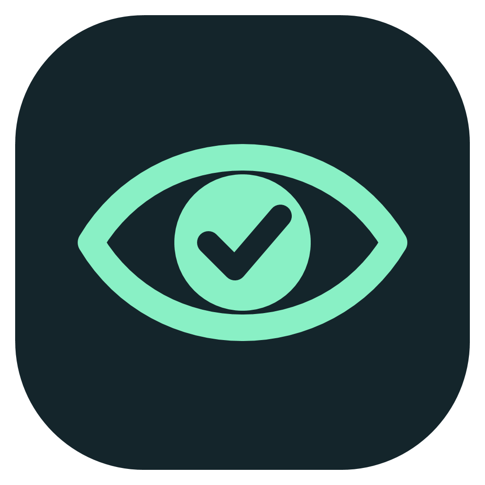
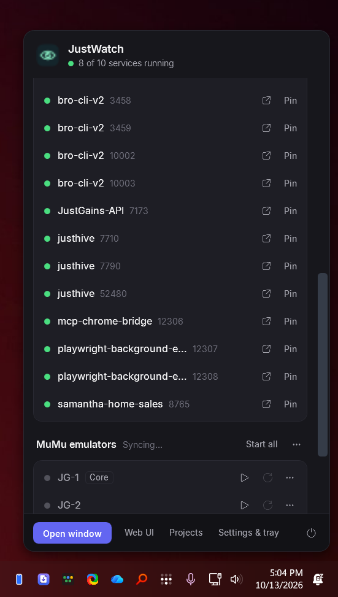
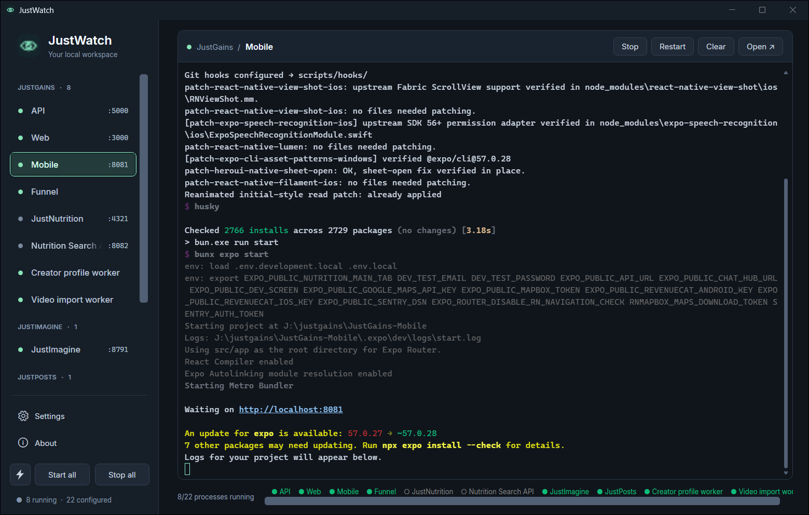
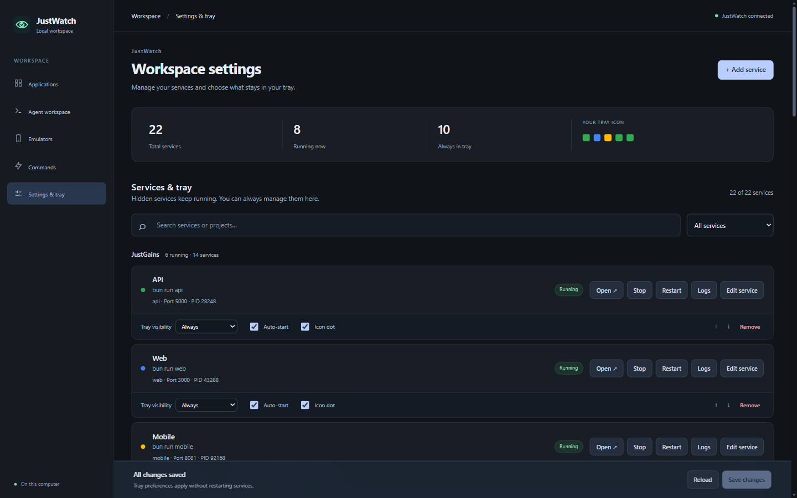
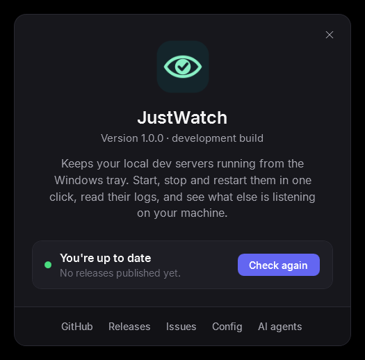

<p align="center">
  
</p>

<h1 align="center">JustWatch</h1>

<p align="center">
  <b>Your local dev servers, kept running from the Windows tray.</b><br>
  Start, stop and restart them in one click, read their logs, and let your AI agents do the same.
</p>

<p align="center">
  <a href="https://github.com/JustSuperHuman/JustWatch/releases/latest"></a>
  
  
</p>

<p align="center">
  
</p>

## What it does

If you work on apps, you probably have a few terminals open running `npm run dev`,
`bun run api`, a database and so on. When one crashes, you find out late. When
you restart your PC, you start them all again by hand.

JustWatch does that for you:

- **Starts your services** when you sign in and **restarts them** when they crash.
- **Shows what's running** in the tray. Click to start, stop, restart or open any of them.
- **Keeps the logs** for each service in one window, with colours and clickable links.
- **Finds other web servers** already listening on your machine so you can open or pin them.
- **Frees stuck ports** before a start, so you never see `EADDRINUSE` again.
- **Gives AI agents an API** to check, restart and read logs, so Claude Code, Codex and friends can fix things themselves.
- **Updates itself** from GitHub releases.

## Install

Open **PowerShell** and paste:

```powershell
irm https://raw.githubusercontent.com/JustSuperHuman/JustWatch/main/install.ps1 | iex
```

That's it. No admin rights needed. It installs to `%LOCALAPPDATA%\Programs\JustWatch`,
adds a Start Menu shortcut, starts with Windows, and puts the eye icon in your tray.
Run the same line again any time to reinstall.

<details>
<summary>Install options and uninstalling</summary>

Set these before running the installer:

| Variable | Effect |
| --- | --- |
| `$env:JUSTWATCH_INSTALL_DIR` | Install somewhere else |
| `$env:JUSTWATCH_VERSION = 'v1.0.0'` | Install a specific release |
| `$env:JUSTWATCH_NO_STARTUP = '1'` | Don't start with Windows |
| `$env:JUSTWATCH_NO_LAUNCH = '1'` | Don't start it after installing |

To uninstall, use **Settings > Apps > JustWatch > Uninstall**, or run:

```powershell
irm https://raw.githubusercontent.com/JustSuperHuman/JustWatch/main/uninstall.ps1 | iex
```

Your config in `%APPDATA%\JustWatch` is kept unless you set `$env:JUSTWATCH_REMOVE_CONFIG = '1'`.
</details>

## Getting started

1. Click the tray icon, then **Settings & tray**. You can also open <http://localhost:6767/services>.
2. Click **Add service**. Give it a name, the command (for example `npm run dev`), the folder and, optionally, the port.
3. Save. JustWatch starts it and keeps it running.

That's all most people need. Everything is stored in
`%APPDATA%\JustWatch\justwatch-config.json` if you'd rather edit a file. See
[`config/justwatch-config.example.json`](config/justwatch-config.example.json).

## Screenshots

**Desktop window**: every service with its live log.



**Settings**: add, edit and organise services, and choose what shows in the tray.



**About & updates**: version, one-click updates and links.



## For AI agents

JustWatch is built to be driven by coding agents. While it runs, it serves:

| URL | What |
| --- | --- |
| <http://localhost:6767/llms.txt> | Plain-language guide: what JustWatch is and how to use it |
| <http://localhost:6767/api> | JSON index of every endpoint |
| <http://localhost:6767/skill> | Installable agent skill (`SKILL.md`) |

The same files sit next to the app: `AGENTS.md`, `llms.txt` and
`skills\justwatch\SKILL.md` in `%LOCALAPPDATA%\Programs\JustWatch\app\`.

**Install the skill** so your agent knows JustWatch automatically:

```powershell
# Claude Code
$d = "$HOME\.claude\skills\justwatch"; mkdir $d -Force | Out-Null
iwr http://localhost:6767/skill -OutFile "$d\SKILL.md"

# Codex and other agents that read ~/.agents/skills
$d = "$HOME\.agents\skills\justwatch"; mkdir $d -Force | Out-Null
iwr http://localhost:6767/skill -OutFile "$d\SKILL.md"
```

Or tell your agent: *"Read http://localhost:6767/llms.txt and install the JustWatch skill."*

Quick reference:

```bash
curl http://localhost:6767/api/services?scope=all          # list everything
curl http://localhost:6767/api/services/api/restart        # restart one
curl "http://localhost:6767/api/services/api/logs?lines=100"  # read its logs
```

## Updates

JustWatch checks GitHub for a new release on launch and every 6 hours. When one
is out, you get a tray notification and an **Update** button in the tray
dashboard. Click it, then **Update now** in About. JustWatch downloads the
release, restarts, and keeps your config. Turn checks off with
`"updates": { "checkAutomatically": false }` in the config.

## Optional extras

These are off until you configure them:

- **Telegram**: post status updates and files to your groups. See [docs/telegram.md](docs/telegram.md).
- **Android emulators**: control MuMu Player instances from the tray. See [docs/mumu.md](docs/mumu.md).
- **Project Library**: browse projects in your code folders at `/projects`. See [docs/project-library.md](docs/project-library.md).
- **Agent workspace**: run Claude CLI or OpenRouter tasks from the desktop window.

## Building from source

You need Windows, the [.NET 10 SDK](https://dotnet.microsoft.com/download) and [Bun](https://bun.sh).

```powershell
git clone https://github.com/JustSuperHuman/JustWatch.git
cd JustWatch
bun run update   # build, deploy to .\app and launch
```

`bun run update` creates `config/justwatch-config.json` from the example the
first time. That file is git-ignored because it holds your API keys.

| Command | Does |
| --- | --- |
| `bun run update` | Stop, rebuild, deploy to `app/`, relaunch |
| `bun run start` / `bun run stop` | Launch or stop without rebuilding |
| `dotnet build JustWatch.slnx` | Build only |
| `dotnet run --project src/JustWatch.Test -- --service-tests` | Run the service manager tests |

### Releasing

Bump `<Version>` in [`Directory.Build.props`](Directory.Build.props), then push a tag:

```powershell
git tag v1.1.0
git push origin v1.1.0
```

GitHub Actions builds a self-contained `JustWatch-win-x64.zip` and publishes the
release. Installed copies pick it up on their next update check.

## Project layout

```
src/JustWatch.Core      services, process manager, web server + API, update checker
src/JustWatch.TrayApp   WPF tray app, flyout, desktop window, About
src/JustWatch.Test      console test runner
skills/justwatch        agent skill (also served at /skill)
llms.txt                agent guide (also served at /llms.txt)
install.ps1             one-line installer
config/                 example configuration
docs/                   feature docs and screenshots
```
